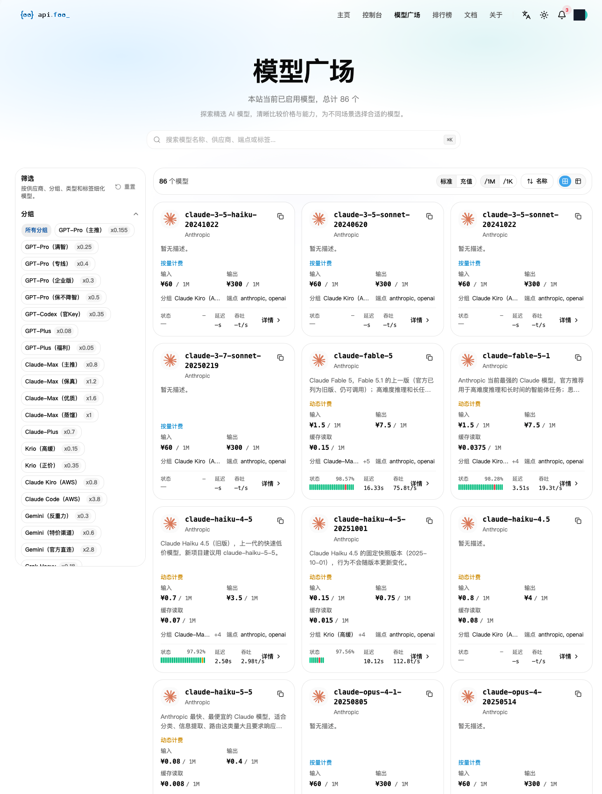
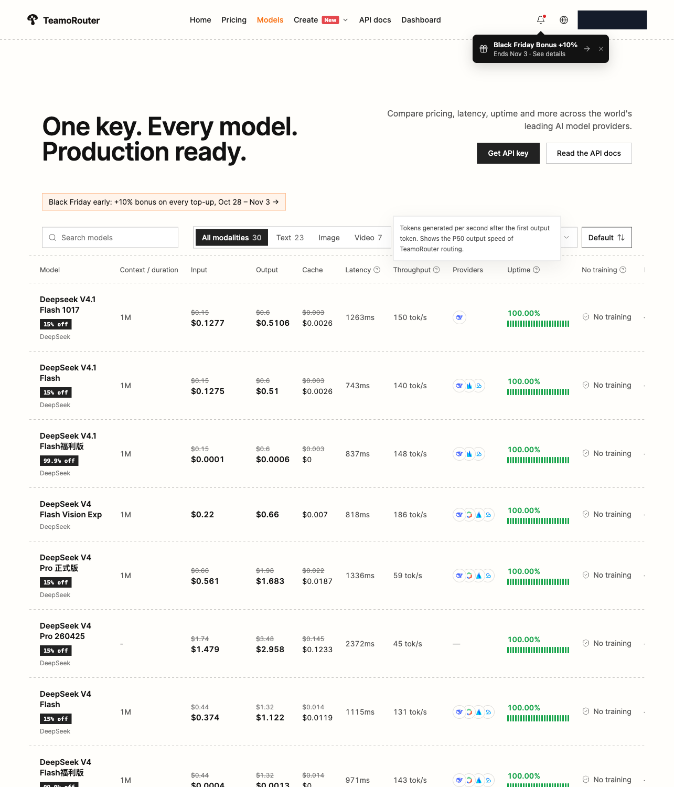
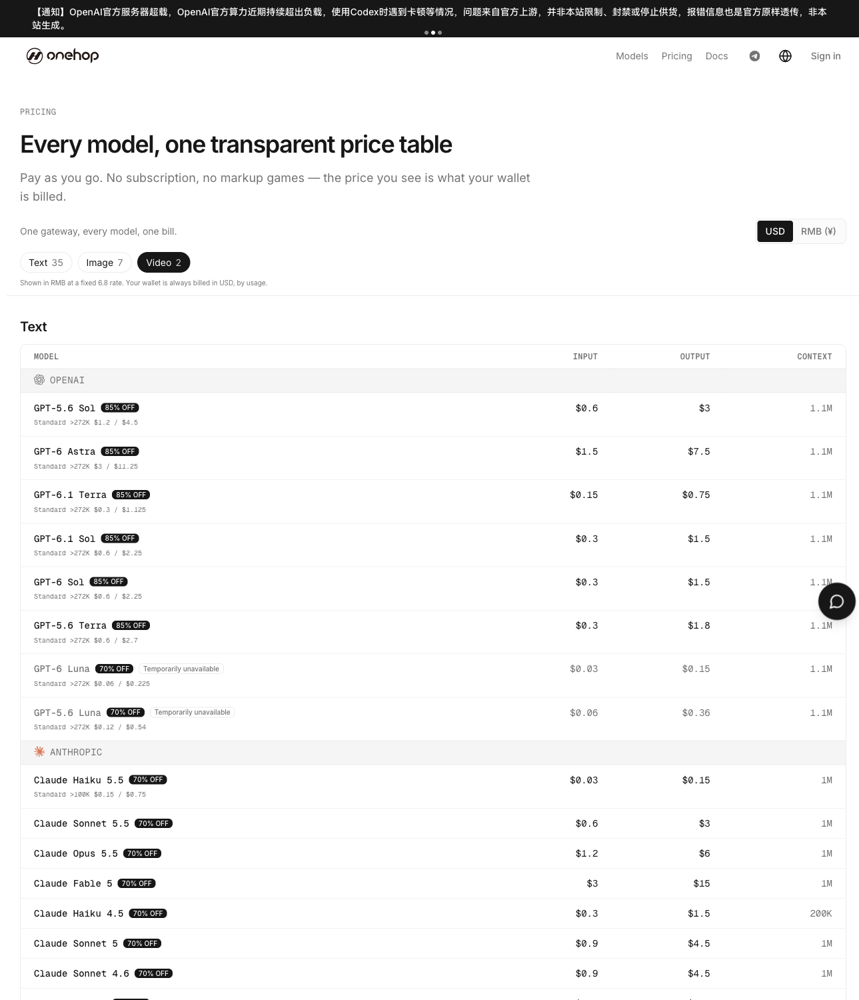

# API Relay Signup Guide: Access Requirements, Pricing Checks and Buying Notes

## The Answer First: Stop Hunting for the Lowest Multiplier

If you just want one entry point for Claude Code, Codex, or your own scripts, start with one of these two — both of
them we have registered and logged into ourselves, and both display a card (Stripe) checkout on their top-up page — we did not test whether a foreign-issued card is accepted:

- **Want the widest model catalog: api.foo.** Our 2026-11-02 capture of the public directory showed 86 models on screen, and a 2026-11-03 re-check found 42 pricing groups across multiple protocol endpoints — good for people who read price tables. The model count moves as the site adds and removes models; check the live page before quoting a number.

- **Want a simpler price list: TeamoRouter.** 30 models, text and video priced separately — good for people who don't want to decode group multipliers.

A third station, **OneHop**, appears below only as a pricing-structure reference: it lists input, cache read, cache
write and long-context tiers separately, which is the clearest structure of the three if you feed large codebases.
We could not complete its sign-up (its anti-bot challenge never loaded for us), so we are **not** recommending it as a

This is not a speed ranking. We have not made paid calls through any of them, so we will not tell you which is "fastest."

### Why This List Is Not a Copy-Paste

Our research log covers 13 candidate entries, not 13 completed sign-up attempts. api.foo, TeamoRouter and Jizhi API reached authenticated accounts. Only api.foo and TeamoRouter completed sign-up end to end. Jizhi's later affiliate-page access failed; that does not undo its successful registration. Some other entries stopped before a registration attempt began. api.foo's first verification code landed in Junk and was alphanumeric — our digits-only parser missed it until we fixed the regex and completed registration in the same session. At TeamoRouter, the invite-code box was mistaken for a captcha field on the first pass; the script safely aborted and we finished with the real `#verify-code` field. OneHop's Turnstile never loaded for us, and we did not bypass it.

That is why the three stations above are not at the same verification level — and we label which is which.
**How far each one actually got:** api.foo and TeamoRouter both completed registration and login on our own account. OneHop never got past its anti-bot challenge on our side, so everything we say about OneHop here comes from its public pages, not from an account we hold. No station below has been topped up or called yet.

### Can an English Reader Actually Register and Pay?

This is the question that decides whether any of the three is worth recommending to an English reader at all, so the answer is stated per station rather than assumed:

- **api.foo** — registration is email + username + a 6-character alphanumeric code (ours arrived in Junk). Payment methods shown on the top-up page include Alipay, WeChat Pay, **Stripe card checkout** and USDT. The page displays a card checkout; we did not complete a card payment, so whether a foreign-issued card is accepted there remains untested. Public pricing is shown in CNY (¥) per 1M tokens or per request.
- **TeamoRouter** — the English-language dashboard is the default surface and it shows a Stripe checkout entry; balances are denominated in USD and top-up options run $10 / $20 / $50 / $200. We did not confirm a live CNY-to-USD rate or an Alipay top-up, so we do not claim one.
- **OneHop** — an English-language public pricing page in USD. We could not complete registration ourselves, so its payment path and documentation support are **unverified** — treat that as unknown, not as working.

We have not funded or called any of the three services discussed here. We inspected public pricing and the api.foo and TeamoRouter account dashboards, not completed payments or usage bills. OneHop remains a public-page reference only; its sign-up and payment path are unverified.

## Which API Protocol and Which Client

Whichever station you pick, the practical question is: can your client speak to it without rewriting your code?

| Station | Protocol shape | Client fit | Evidence level |
|---|---|---|---|
| **api.foo** | Model cards are tagged by endpoint family — Anthropic-style (`/v1/messages`), OpenAI Chat/Responses-style, Gemini-style, plus image models. Endpoint tags overlap, so **you cannot add them up to get a model count**. | Claude Code (Anthropic endpoint), Codex (OpenAI endpoint), or your own script — **you still have to send one request to see it work** | Endpoint tags read off the public model directory; **we made no request** |
| **TeamoRouter** | Public base URL shown on its own pages in the form `https://api.teamorouter.cn/v1`; the vendor states OpenAI- and Anthropic-compatible access | Same client mapping as above | ⚠️ **Vendor statement** — we did not call it; treat "compatible" as unverified until your own request succeeds |
| **OneHop** | Public pricing page lists input / cache read / cache write / long-context tiers separately | — | ⚠️ We could not sign up; **protocols and client fit unknown** |

**Why "endpoint tag" is not "model count"**: a single model can be reachable through more than one endpoint
family, so a directory that lists 81 Chat + 24 Anthropic + 24 Gemini + 11 Response + 5 image entries is still
one catalog of unique models — the counts overlap by design.

**What would actually settle it** (and what we did **not** do): create one API key, send one minimal request,
and read one bill line. We have funded nothing and called nothing, so no claim here rests on a measured
response, latency or deduction.

## Pricing Checks Before You Top Up

⚠️ **There is no safe one-line formula here, and we do not give you one.** A listed per-1M-token price is not a bill: you cannot multiply raw token counts by a per-1M price and call the result what you will pay. **Check these before you top up:**

1. **Unit of the listed price.** Is it per 1M tokens, per request, per image, or per second of video?
2. **Does the price already include the group multiplier?** If it does, multiplying again double-counts it.
3. **Cache overlap.** Are cache-read tokens counted again as input tokens on the same request?
4. **Top-up conversion.** What you pay versus what lands in your account — including any exchange rate or bonus.
5. **Your currency.** Convert once, at a rate you can name, not at a rate the page implies.

**Five traps that turn a "0.1x multiplier" into a normal bill:**

1. **Top-up ratio.** What you pay vs. what lands in your account.
2. **Group multiplier.** The same model can sit in different pricing groups.
3. **Output price.** Usually several times input — marketing quotes input only.
4. **Cache pricing.** Reads and writes can be two different numbers.
5. **Long-context tiers.** Cross the threshold and the price table changes.

## Three Traps That Make "Cheap" Expensive

### Trap 1: Balance Units Are Not Dollars

Most relay balances are internal credits. ¥10 of balance is not $10 of API spend. Always compute the top-up ratio first.

### Trap 2: Only the Input Multiplier Gets Advertised

If output costs 3–5× input and your workload is code generation, your real bill is dominated by output. Do the math on your own usage profile before picking a "cheap" station.

### Trap 3: Same Model Name ≠ Same Source

Relays route to different upstreams. A model with the same name can differ in latency, context limits, and behavior. Test with your real prompts before committing.

## What a Real Billing Proof Looks Like

We will not claim "verified billing" until we can show: one Request ID, its usage fields, the bill line, and the balance before and after — all from the same account. That requires a funded call, which we have not made. When we do, this section gets the screenshots.

## How to Choose in 60 Seconds

| Your priority | Start with | Why |
|---|---|---|
| Model variety + protocols | **api.foo** | 86 models on screen in our 2026-11-02 capture, 42 groups at our 2026-11-03 re-check, multi-protocol endpoints |
| Simple, readable pricing | **TeamoRouter** | 30 models, text/video split |
| Long-context economics | **OneHop** (reference only, sign-up unverified by us) | Cache and long-context priced separately |

**Before you commit real money:** send one minimal request, read one real bill, and check whether the balance deduction matches. Then scale up.

<small>Fact-checked against public pages on 2026-11-02 (model count: 86 shown on screen), group count re-checked 2026-11-03 (42 groups). No paid calls were made through any station listed. Terms change — verify current pricing at checkout.</small>
